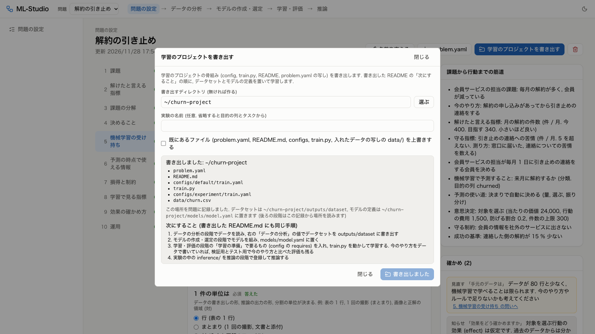
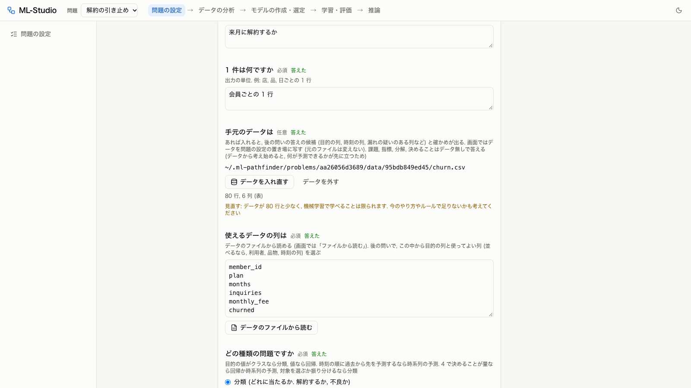
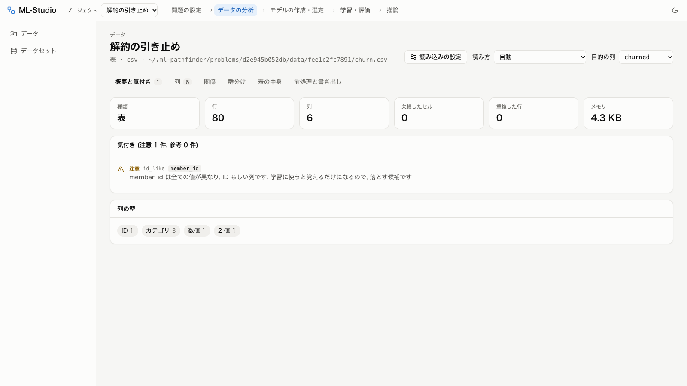
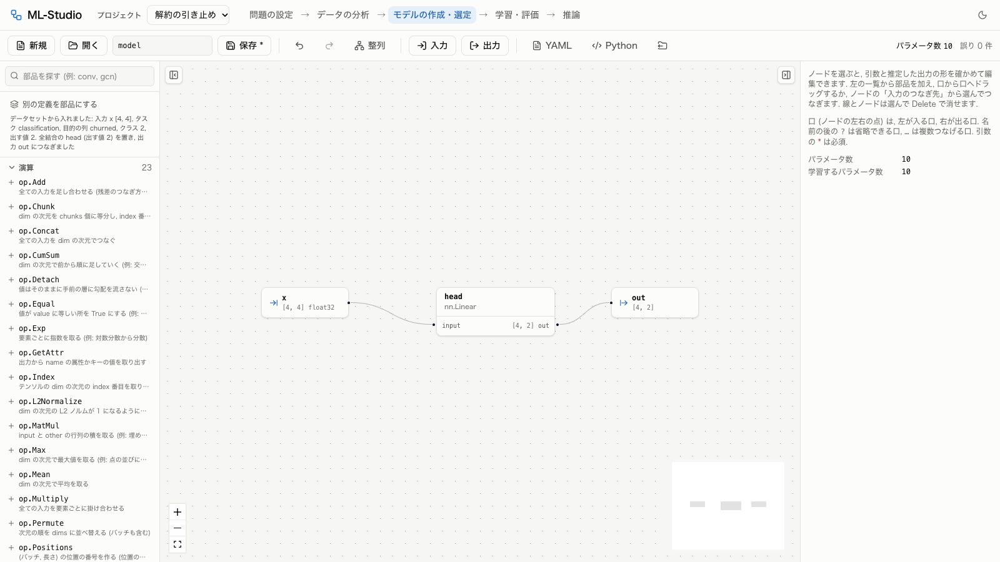
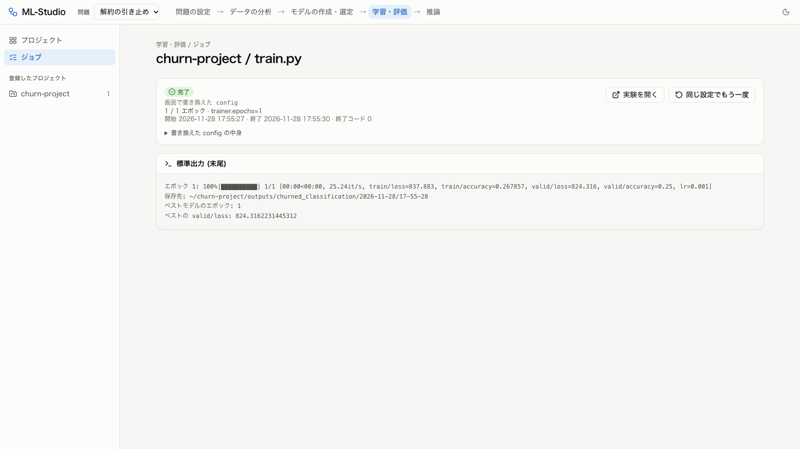
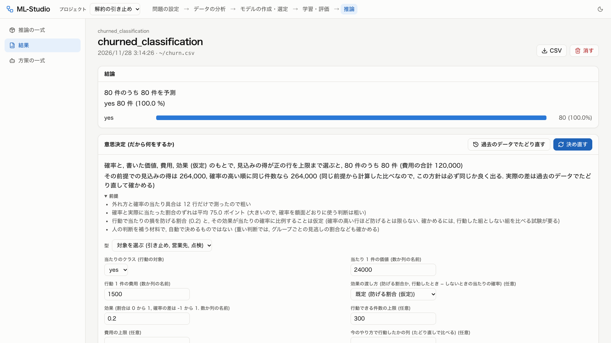
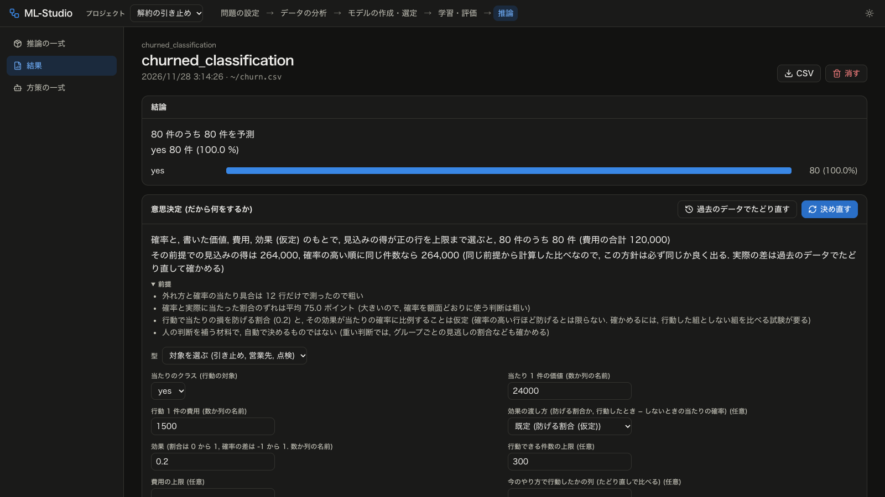

# ML-Studio

機械学習全般を GUI で完結させるための統合アプリ. 5 つの段階のアプリ (問題の設定, データの分析, モデルの作成・選定, 学習・評価, 推論) を 1 つのコマンドと 1 つのポートで開き, 上の帯の段階の並びで行き来する. 問題の設定の段階は [ML-Pathfinder](https://github.com/victor-von-pooh/ML-Pathfinder), データの分析の段階は [ML-Fathom](https://github.com/victor-von-pooh/ML-Fathom), モデルの作成・選定の段階は [ML-CreateArchitecture](https://github.com/victor-von-pooh/ML-CreateArchitecture), 学習・評価の段階は [ML-Dashboard](https://github.com/victor-von-pooh/ML-Dashboard), 推論の段階は [ML-Provide](https://github.com/victor-von-pooh/ML-Provide) が受け持つ.

上の帯で選んだ 1 つの問題 (問題の設定の段階で作る 1 つ) を全ての段階が開くので, 前の段階の結果 (問題に記録した学習のプロジェクト, 書き出したデータセット, 保存したモデルの定義, 学習の実験) を, 値やファイルを手で写さずに次の段階で使える.



<table>
  <tr>
    <td width="50%"></td>
    <td width="50%"></td>
  </tr>
  <tr>
    <td><b>問題の設定</b>. 見本か新しく作った問題の問いに答え, 手元のデータを入れて学習のプロジェクトを書き出す</td>
    <td><b>データの分析</b>. 選んだ問題から始めて表を分析し, 前処理をかけたデータセットを学習のプロジェクトへ書き出す</td>
  </tr>
  <tr>
    <td></td>
    <td></td>
  </tr>
  <tr>
    <td><b>モデルの作成・選定</b>. データセットに合う入力と出力を作ってモデルを組み, 学習のプロジェクトに保存する</td>
    <td><b>学習・評価</b>. 記録した学習のプロジェクトを登録し, 画面から学習を起動して進み具合を見る</td>
  </tr>
  <tr>
    <td></td>
    <td></td>
  </tr>
  <tr>
    <td><b>推論</b>. 学習した実験から推論の一式を登録し, データを推論して結論と意思決定を見る</td>
    <td><b>明暗</b>. 上の帯の切り替えが全ての段階の画面に効く</td>
  </tr>
</table>

画面の例は, ML-Pathfinder の見本「解約の引き止め」に作り物の 80 行の会員の表を入れ, [操作ガイド](docs/GUIDE.md)の順に 5 つの段階を通したもの. 置き場は既定で, 書き出し先はホームの下 (`~`) で示している.

## できること

- **1 つのコマンドと 1 つのポート**: 5 つの段階の画面と API を 1 つのアプリに載せ, `make serve` で起動して 1 つの URL で開く. 段階の画面は, その段階を初めて開くときに読む
- **段階の並び**: 上の帯の「問題の設定 → データの分析 → モデルの作成・選定 → 学習・評価 → 推論」をいつでも押して段階を移る. 前の段階に戻って直せ, 今の段階を押し直すと段階の最初の画面に戻る. ブラウザの戻ると進むも使える
- **問題の欄**: 問題を 1 つ選ぶと, 全ての段階がその問題を開く (データの分析はその問題から始め, モデルの作成・選定は記録したデータセットと保存先を入れ, 学習・評価は記録した学習のプロジェクトを出し, 推論はその実験だけを並べる). 問題の設定の段階で問題を作るか開くと, 欄もそれに替わる. 再読み込みしても選びは残る
- **段階の受け渡し**: 問題に記録した場所から, データセット, モデルの定義, 学習の実験, 推論の一式を次の段階が読む. 値やファイルを段階の間で手で写さない
- **書きかけの下書き**: 保存していない書きかけ (モデルの定義, 学習の起動の書き換えなど) は, 段階を移るときと欄の問題を替えるときに下書きに残り, 戻ると下書きから戻せる
- **単独と同じ置き場**: 各段階は各アプリを単独で起動したときと同じ置き場を開くので, 単独で作ったものを殻で, 殻で作ったものを単独で開ける
- ライトとダークの表示 (上の帯で切り替え, 全ての段階に効く)

## 使い方

### 必要なもの

- [uv](https://docs.astral.sh/uv/) 0.13.10 以上 (Python は uv が用意する. 3.10 以上)
- Node.js 24 以上と [pnpm](https://pnpm.io/) 11 以上 (`corepack enable` で `package.json` の版が入る. `corepack enable` が使えない環境 (corepack が付かない版の Node.js や, 別の道具で入れた Node.js) では `npm install -g pnpm@11` などで入れる)

### 導入と起動

```bash
git clone --recursive https://github.com/victor-von-pooh/ML-Studio.git
cd ML-Studio
make setup   # submodule, Python と Node.js の依存 (外部のライブラリの部品も使うなら make setup EXTRAS="timm")
make serve   # 画面をビルドして http://127.0.0.1:8760 で起動 (Ctrl+C で止める)
```

初めての `make setup` は Python の依存 (PyTorch など) を取ってくるので, 時間と容量 (バックエンドの環境 `backend/.venv` で約 1 GB) がかかる.

起動すると `ML-Studio を開く: http://127.0.0.1:8760/api/auth?token=...` の行が出るので, その URL をブラウザで開く (トークンは起動ごとに変わる. 環境変数 `ML_STUDIO_TOKEN` で決められる). ポートは `make serve PORT=8800` のように変えられる. 他のホストで待ち受ける場合は `ml-studio --host <ホスト> --allowed-host <接続に使う名前>` で起動する.

上の帯の問題の欄で問題を選ぶと, 全ての段階がその問題を開く.

#### 置き場

各段階は, 各アプリを単独で起動したときと同じ置き場を開く. 環境変数を設定すればその場所, 無ければホームの下の既定の場所. 問題は問題の設定の段階の置き場に置き, 他の 4 つの段階も同じ置き場の問題を読む.

| 段階 | アプリ | 既定の場所 | 環境変数 | 置くもの |
| --- | --- | --- | --- | --- |
| 問題の設定 | ML-Pathfinder | `~/.ml-pathfinder/` | `ML_PATHFINDER_HOME` | 問題 |
| データの分析 | ML-Fathom | `~/.ml-fathom/` | `ML_FATHOM_HOME` | 登録したデータ, 前処理の手順, 書き出したデータセット |
| モデルの作成・選定 | ML-CreateArchitecture | `~/.ml-createarchitecture/` | `ML_CREATEARCHITECTURE_HOME` | 保存したモデルの定義 |
| 学習・評価 | ML-Dashboard | `~/.ml-dashboard/` | `ML_DASHBOARD_HOME` | 登録した学習のプロジェクト, 学習のジョブの記録 |
| 推論 | ML-Provide | `~/.ml-provide/` | `ML_PROVIDE_HOME` | 登録した推論の一式, 推論の結果 |

普段の置き場を使わずに試す場合は, 5 つの環境変数を別の場所にして起動する (例は[操作ガイド](docs/GUIDE.md#1-起動する)の「置き場」).

#### 外部のライブラリの部品

モデルの作成・選定の段階では, 外部のライブラリのうち既定で殻の環境に入っているのは torchvision だけなので, 使える外部のライブラリの部品はおおむね torchvision のものに限る. 入っていないライブラリ (huggingface, timm など) は, よく使う部品だけが部品の一覧に薄く載り, 置けず, 理由 (そのライブラリが入っていないことと入れ方) が出る. ライブラリを入れると, そのライブラリの部品が全て一覧に載る. 他のライブラリの部品を使う場合は, `make setup EXTRAS="timm einops"` のように ML-CreateArchitecture の extra を空白で区切って選ぶ.

- 選べる名前は `make extras-list` で出る. `project` は殻に既に入っているので, 書いても書かなくてもよい (一覧の理由に出る ML-CreateArchitecture を単独で起動したときの入れ方 `make setup EXTRAS="project …"` をそのまま使える)
- `make setup` は選んだ extra だけにし直し, `make extras EXTRAS="timm"` は前に足した extra を残して足す. どちらも入っている依存の版は変えない
- `make setup` を `EXTRAS` 無しで実行すると既定に戻る
- Linux では torchaudio の部品は足しても使えない

#### 学習の環境

学習・評価の段階の学習は, 登録した学習のプロジェクトの仮想環境 (プロジェクトか, それを含むリポジトリの `.venv` か `venv`. 登録するときに Python を選べ, 無ければ殻の Python) で別のプロセスとして動く.

#### 自作の部品と手順

自作の部品と手順は, 各アプリの起動の設定の環境変数で読み込む (モデルの作成・選定の段階は `ML_CREATEARCHITECTURE_MODULES`, 推論の段階は部品を `ML_PROVIDE_UNITS`, 繰り返しの手順を `ML_PROVIDE_PROCEDURES`. どれもモジュールの名前を `,` で区切る). 自作の部品は 2 つの段階で 1 つの登録簿を共有するので, 同じモジュールを両方に書いてよい. 読めないモジュールがあると, 殻は `起動できません: ...` の理由を出して終わる.

## 文書

- [操作ガイド](docs/GUIDE.md): 画面の順の操作ガイド (殻の使い方と, 見本で 5 つの段階を通す流れ). 各段階の細かい操作は各アプリの操作ガイドを指す. 最後の章が「困ったとき」
- [設計](docs/DESIGN.md): 今の設計と決まり (各アプリとの約束, 画面, API, 置き場, 安全)
- [TODO](TODO.md): まだやっていないこと (優先度の順)

## 開発

```bash
make dev     # API と画面の開発用のサーバー (開く URL を出す)
make check   # lint, 型検査, テスト
cd frontend && pnpm e2e   # 殻の通しのテスト
```

`make dev` の画面のサーバーは `/api` を Host を変えずに転送する (`frontend/vite.config.ts` の `changeOrigin: false`). バックエンドは Origin と Host が違う書き込みを断るので, Host を転送先に変えると画面からの書き込みが全て 403 になる.

| ディレクトリ | 内容 |
| --- | --- |
| `backend/` | 殻の API (Python, FastAPI). 確かめと画面の配信を持ち, 各段階の API を載せる |
| `frontend/` | 殻の画面 (TypeScript, React, Vite). 上の帯と, 各段階の画面の根の部品を載せる |
| `ML-Pathfinder/` | 問題の設定の段階のアプリ (submodule) |
| `ML-Fathom/` | データの分析の段階のアプリ (submodule) |
| `ML-CreateArchitecture/` | モデルの作成・選定の段階のアプリ (submodule) |
| `ML-Dashboard/` | 学習・評価の段階のアプリ (submodule) |
| `ML-Provide/` | 推論の段階のアプリ (submodule) |
| `docs/` | 操作ガイド, 設計, README と操作ガイドの画面の例 (`images/`) |

## ライセンス

MIT
