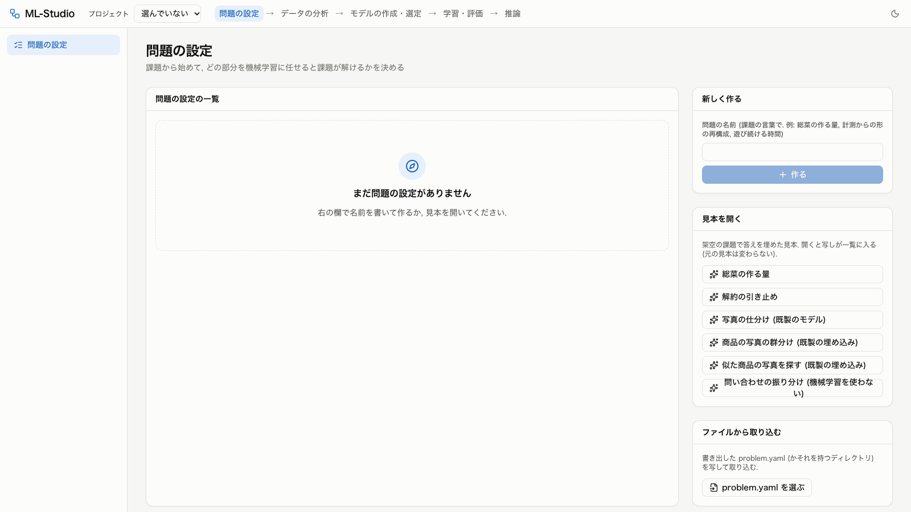
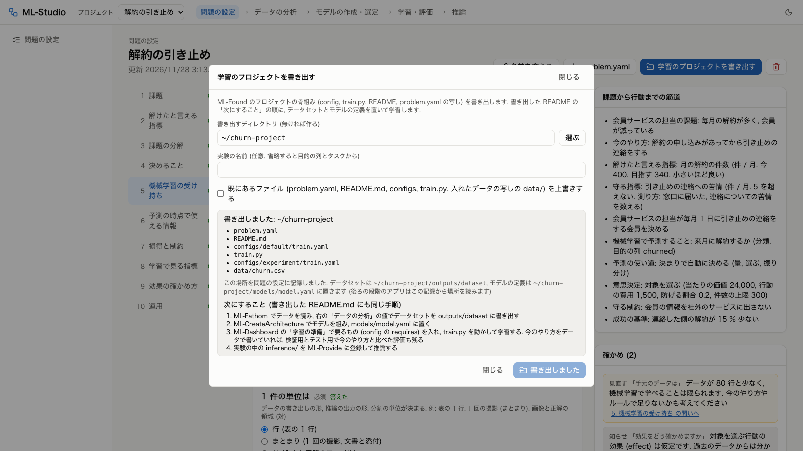
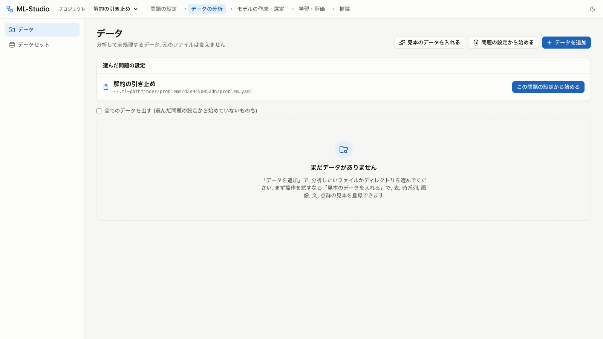
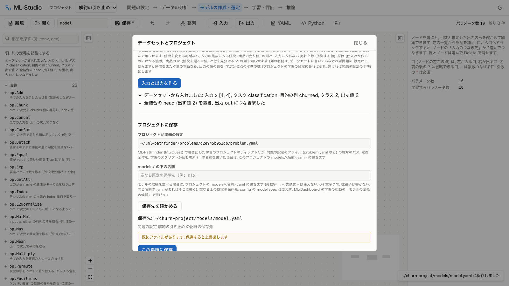
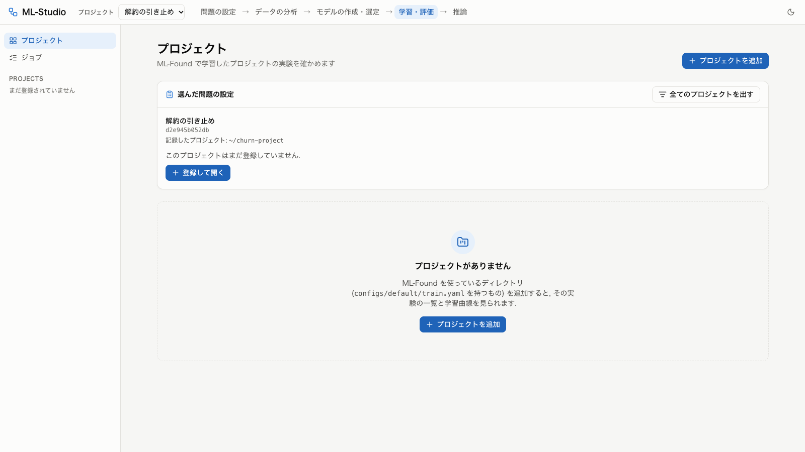
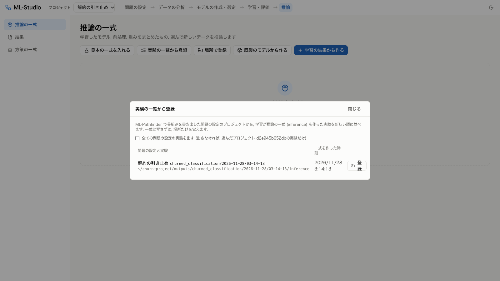
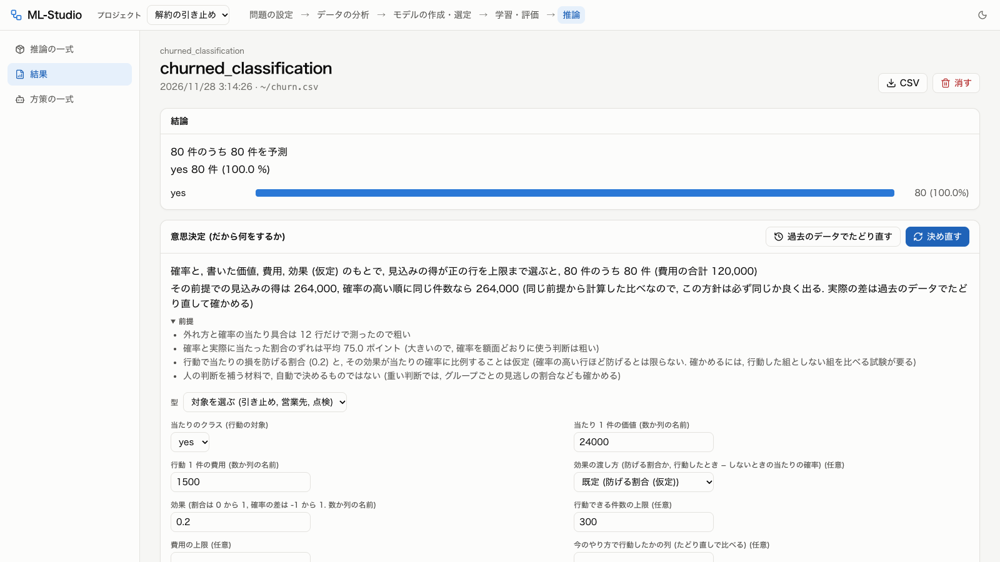

# ML-Studio 操作ガイド

ML-Studio の使い方を, 起動してから 5 つの段階 (問題の設定 → データの分析 → モデルの作成・選定 → 学習・評価 → 推論) を通すまでの画面の順に説明する. 2 章から 4 章は殻 (上の帯) の使い方, 5 章から 9 章は ML-Pathfinder の見本「解約の引き止め」と小さな表で 5 つの段階を通す流れ. 各段階の細かい操作は, その段階を受け持つアプリの操作ガイドを指す. 設計の方針と API は [DESIGN.md](DESIGN.md) を参照.

## 目次

0. [準備](#準備)
1. [起動する](#1-起動する)
2. [画面の見方](#2-画面の見方)
3. [プロジェクトを選ぶ](#3-プロジェクトを選ぶ)
4. [段階を移るときの書きかけ](#4-段階を移るときの書きかけ)
5. [問題の設定: 学習のプロジェクトを書き出す](#5-問題の設定-学習のプロジェクトを書き出す)
6. [データの分析: データセットを書き出す](#6-データの分析-データセットを書き出す)
7. [モデルの作成・選定: モデルの定義を保存する](#7-モデルの作成選定-モデルの定義を保存する)
8. [学習・評価: 学習する](#8-学習評価-学習する)
9. [推論: 推論する](#9-推論-推論する)
10. [困ったとき](#10-困ったとき)

## 準備

この手順書でよく使う言葉.

| 言葉 | 意味 |
| --- | --- |
| 殻 | ML-Studio のアプリ. 5 つの段階のアプリを 1 つの画面に載せる |
| 段階 | 問題の設定, データの分析, モデルの作成・選定, 学習・評価, 推論の 5 つ. それぞれを 1 つのアプリが受け持つ |
| 上の帯 | 画面の一番上の帯. アプリの名前, プロジェクトの欄, 段階の並び, 明暗の切り替えを持つ |
| プロジェクト | 上の帯の欄で選ぶ 1 つの問題の設定. 全ての段階が同じものを開く |
| 学習のプロジェクト | 問題の設定の段階で書き出す ML-Found のプロジェクトの骨組み (config, `train.py`, README, `problem.yaml` の写し). 書き出した場所は問題の設定に記録され, 後ろの段階はこの記録から場所を読む |
| 推論の一式 | 学習した実験の中に作られる, 前処理, モデル, 重みをまとめたもの. 推論の段階に登録して使う |

始める前に, ML-Studio を README の「導入と起動」の手順で導入しておく (`make setup`).

5 章から 9 章を試すには, 見本「解約の引き止め」と同じ列の小さな表 (会員ごとに 1 行) を用意する. 書き出した学習のスクリプトは数の列だけを読むので, 種類の列 (`plan`) も数で書く. 次のコマンドで, 今のディレクトリに 80 行の `churn.csv` を作れる.

```bash
python3 - <<'PY'
rows = ["member_id,plan,months,inquiries,monthly_fee,churned"]
for i in range(80):
    plan, months, inquiries = i % 3, 1 + (i * 7) % 36, (i * 5) % 6
    # 問い合わせが多く, 入って短い会員が解約する
    churned = "yes" if inquiries >= 3 and months < 20 else "no"
    rows.append(f"m{i},{plan},{months},{inquiries},{1000 + plan * 500},{churned}")
open("churn.csv", "w").write("\n".join(rows) + "\n")
PY
```

## 1. 起動する

ML-Studio はローカルで動く Web アプリ. 端末で起動して, 表示された URL をブラウザで開く.

1. ML-Studio を clone したディレクトリで `make serve` を実行する. 画面をビルドしてから `http://127.0.0.1:8760` で待ち受ける. 端末は使ったままになるので, 止めるまでそのままにする
2. 端末に `ML-Studio を開く: http://127.0.0.1:8760/api/auth?token=…` と出るので, その URL を開く. トークンは起動するたびに変わる
3. 問題の設定の段階 (`/problem`) の一覧の画面が開けば準備完了

```bash
make serve
```



> **トークンを毎回同じにする**
> `ML_STUDIO_TOKEN=好きな文字列 make serve` で起動すると, `http://127.0.0.1:8760/api/auth?token=好きな文字列` を開けば入れる.

> **置き場**
> 各段階は, 各アプリを単独で起動したときと同じ置き場 (`~/.ml-pathfinder/` など. 環境変数 `ML_PATHFINDER_HOME` などで変えられる) を開く. 置き場の一覧は README の「導入と起動」にある. 試すだけで普段の置き場を使いたくない場合は, 5 つの環境変数を別の場所にして起動する.

## 2. 画面の見方

画面は, 上の帯と, その下の段階の画面からなる.

| 部分 | 内容 |
| --- | --- |
| アプリの名前 | 左上の「ML-Studio」 |
| プロジェクトの欄 | 全ての段階が開く問題の設定を選ぶ (3 章) |
| 段階の並び | 問題の設定 → データの分析 → モデルの作成・選定 → 学習・評価 → 推論. 今の段階に色が付く |
| 明暗の切り替え | 右上の月 (暗い表示にする) と太陽 (明るい表示にする) のボタン |
| 段階の画面 | 選んだ段階のアプリの画面. 段階の中の移動 (左の欄の項目など) は段階の画面の中にある |

- 段階の並びはいつでも押せる. 押すとその段階の最初の画面に移り, 選んだプロジェクトは引き継ぐ. 前の段階に戻って直してから, また先に進める
- 今の段階を押し直すと, 段階の最初の画面から開き直す (段階の中で迷ったときに最初へ戻るため)
- ブラウザの戻ると進むで, 段階をまたいで戻れる. 段階の画面の URL (`/data/sources/…` など) を直に開くか再読み込みしても, その画面が出る
- 段階の画面は, その段階を初めて開くときに読む. 読む間は段階の場所に「段階の画面を読み込んでいます」と出る
- 明暗の切り替えは全ての段階の画面に効き, ブラウザに残る (次に開いても同じ表示)
- キーボードでは, ページの先頭で Tab を押すと「段階の画面へ移る」が出て, 上の帯を飛ばして段階の画面に移れる

## 3. プロジェクトを選ぶ

上の帯の「プロジェクト」の欄には, 問題の設定の段階の置き場にある問題の設定が名前で並ぶ. 1 つ選ぶと, 全ての段階がその問題の設定を開く.

| 段階 | 選んだ問題の設定の開き方 |
| --- | --- |
| 問題の設定 | その問題の設定を開く |
| データの分析 | データの画面に「選んだ問題の設定」のカードが出て, 「この問題の設定から始める」で始める (6 章) |
| モデルの作成・選定 | 「データセットとプロジェクト」に「選んだ問題の設定」が出て, 記録のデータセットと保存先が入る (7 章) |
| 学習・評価 | プロジェクトの画面に「選んだ問題の設定」が出て, 記録した学習のプロジェクトを登録して開ける (8 章) |
| 推論 | 「実験の一覧から登録」に, その問題の設定のプロジェクトの実験だけが並ぶ (9 章) |

- 問題の設定の段階で新しく作るか, 見本や一覧から開くと, 欄もその問題の設定に替わる. 消すと欄の一覧からも消える
- 「選んでいない」を選ぶと, 各段階は問題の設定を選ばずに開く
- 選んだ問題の設定はブラウザに残り, 再読み込みしても選んだまま開く

## 4. 段階を移るときの書きかけ

殻は段階の移動を止めず, 「保存していない変更があります」のような確かめも出さない. その代わり, 保存していない書きかけを持つ画面は, 段階を移るとき, 今の段階を押し直すときと, 欄のプロジェクトを替えるときに, 書きかけをブラウザに下書きとして残す. 戻ると, 各段階の画面が下書きを戻すか, 戻すかを選ばせる.

| 段階 | 下書きの戻し方 | 詳しくは |
| --- | --- | --- |
| モデルの作成・選定 | 戻ると上に「保存していない定義 … の下書きがあります」と出る. 「下書きを開く」で戻し, 「下書きを捨てる」で捨てる | [ML-CreateArchitecture の操作ガイドの「8. 保存と下書き」](https://github.com/victor-von-pooh/ML-CreateArchitecture/blob/main/docs/GUIDE.md#8-保存と下書き) |
| 学習・評価 | 同じプロジェクトの学習の起動の画面を開くと「保存していない書き換えを下書きから戻しました」と出る. 要らなければ「下書きを捨てる」 | [ML-Dashboard の操作ガイドの「7. 画面から学習を起動する」](https://github.com/victor-von-pooh/ML-Dashboard/blob/main/docs/GUIDE.md#7-画面から学習を起動する) |
| 推論 | 「学習の結果から作る」を開くと, 書きかけの欄が戻り「作っていない書きかけ (時刻) を欄に戻しました」と出る. 要らなければ「書きかけを捨てる」 | [ML-Provide の操作ガイドの「2. 見本の一式を入れる」](https://github.com/victor-von-pooh/ML-Provide/blob/main/docs/GUIDE.md#2-見本の一式を入れる) |

問題の設定の段階は, 答えを欄を離れるたびに保存する (「「…」を保存しました」と出る) ので, 段階を移っても答えは残る.

## 5. 問題の設定: 学習のプロジェクトを書き出す

問題の設定の段階 (ML-Pathfinder) で, 見本を開いて手元の表を入れ, 学習のプロジェクトを書き出す.

1. 段階の並びの「問題の設定」を押し, 一覧の「見本を開く」の「解約の引き止め」を押す. 見本の写しが開き, 上の帯の欄も「解約の引き止め」に替わる
2. 左の節の「5 機械学習の受け持ち」を押し, 「手元のデータは」の「データを入れる」を押す. 選ぶ対話の「パス」に準備で作った `churn.csv` の場所を書いて「移動」を押し, 「選ぶ」を押す
3. 「80 行, 6 列 (表)」と出て, 列の名前が入る. 小さな表なので「見直す」の確かめが出るが, 直すところは無い
4. 上の「学習のプロジェクトを書き出す」を押し, 「書き出すディレクトリ (無ければ作る)」に書き出し先 (例 `~/churn-project`) を書いて「書き出す」を押す
5. 「この場所を問題の設定に記録しました」と出る. データセットは `<書き出し先>/outputs/dataset`, モデルの定義は `<書き出し先>/models/model.yaml` に置くと出る. 「閉じる」で対話を閉じる



問いの答え方, データの入れ方, 書き出しの細かい操作は, [ML-Pathfinder の操作ガイド](https://github.com/victor-von-pooh/ML-Pathfinder/blob/main/docs/GUIDE.md)の「[2. 問題の設定を作る](https://github.com/victor-von-pooh/ML-Pathfinder/blob/main/docs/GUIDE.md#2-問題の設定を作る)」「[3. 問いに答える](https://github.com/victor-von-pooh/ML-Pathfinder/blob/main/docs/GUIDE.md#3-問いに答える)」「[4. 手元のデータを入れる](https://github.com/victor-von-pooh/ML-Pathfinder/blob/main/docs/GUIDE.md#4-手元のデータを入れる)」「[6. 学習のプロジェクトを書き出す](https://github.com/victor-von-pooh/ML-Pathfinder/blob/main/docs/GUIDE.md#6-学習のプロジェクトを書き出す)」を参照.

## 6. データの分析: データセットを書き出す

データの分析の段階 (ML-Fathom) で, 選んだ問題の設定から始め, 問題の設定に記録した場所へデータセットを書き出す.

1. 段階の並びの「データの分析」を押す. データの画面の「選んだ問題の設定」のカードに「解約の引き止め」が出る
2. 「この問題の設定から始める」を押す. 問題の設定に入れた表が登録されて開き, 目的の列 (`churned`) が入っている. 「概要と気付き」などのタブで表を分析できる
3. 「前処理と書き出し」のタブを押す. 問題の設定から入った手順 (使わない列 `member_id` を落とすなど) が並び, 「保存と書き出し」の欄の最後に「プロジェクトへ書き出す」と書き出し先 (`<書き出し先>/outputs/dataset`) が出る
4. 「プロジェクトへ書き出す」を押すと「プロジェクトへ書き出しました」と出て, モデルを組むときの数 (入力の形, 出力の幅) が出る



表の分析と前処理の組み立ての細かい操作は, [ML-Fathom の操作ガイド](https://github.com/victor-von-pooh/ML-Fathom/blob/main/docs/GUIDE.md)の「[4. 表を分析する](https://github.com/victor-von-pooh/ML-Fathom/blob/main/docs/GUIDE.md#4-表を分析する)」「[5. 前処理を組み立てて書き出す](https://github.com/victor-von-pooh/ML-Fathom/blob/main/docs/GUIDE.md#5-前処理を組み立てて書き出す)」「[10. 問題の設定から始める](https://github.com/victor-von-pooh/ML-Fathom/blob/main/docs/GUIDE.md#10-問題の設定から始める)」を参照.

## 7. モデルの作成・選定: モデルの定義を保存する

モデルの作成・選定の段階 (ML-CreateArchitecture) で, 書き出したデータセットに合う入力と出力を作り, 学習のプロジェクトにモデルの定義を保存する.

1. 段階の並びの「モデルの作成・選定」を押す. モデルを組むキャンバスが開く
2. 上の「データセットとプロジェクト」を押す (幅の狭い画面ではフォルダのアイコンだけ). 「選んだ問題の設定」に「解約の引き止め」が出て, 「データセットのディレクトリ」に `<書き出し先>/outputs/dataset` が入る
3. 「入力と出力を作る」を押すと「データセットから入れました」と出て, 入力 `x` と, 全結合の `head` と, 出力 `out` が置かれる
4. 「プロジェクトに保存」の保存先に `<書き出し先>/models/model.yaml` が出ているので, 「この場所に保存」を押す. 「… に保存しました」と出る
5. 「閉じる」で対話を閉じる. 上の右に「誤り 0 件」と出る



モデルを組む細かい操作 (部品を置く, つなぐ, 誤りを直す) と, 学習のプロジェクトにつなぐ操作は, [ML-CreateArchitecture の操作ガイド](https://github.com/victor-von-pooh/ML-CreateArchitecture/blob/main/docs/GUIDE.md)の「[3. 最初のモデルを作る](https://github.com/victor-von-pooh/ML-CreateArchitecture/blob/main/docs/GUIDE.md#3-最初のモデルを作る)」と「9. 作った定義を使う」の「[学習のプロジェクトにつなぐ](https://github.com/victor-von-pooh/ML-CreateArchitecture/blob/main/docs/GUIDE.md#学習のプロジェクトにつなぐ)」を参照.

## 8. 学習・評価: 学習する

学習・評価の段階 (ML-Dashboard) で, 問題の設定に記録した学習のプロジェクトを登録し, 画面から学習を起動する.

1. 段階の並びの「学習・評価」を押す. プロジェクトの画面の「選んだ問題の設定」に「解約の引き止め」と記録したプロジェクト (`<書き出し先>`) が出る
2. 「登録して開く」を押すと, 学習のプロジェクトが登録されて開く
3. 「学習を起動」を押す. 学習の起動の画面で, 試すだけなら「エポック数」を `1` にする
4. 「学習を開始」を押すと, ジョブの画面に移る. 学習が終わると「終了コード 0」が出て, 標準出力の末尾に保存先 (`<書き出し先>/outputs/…`) が出る. 学習した実験は「実験を開く」で見られる



学習は, 登録した学習のプロジェクトの仮想環境 (プロジェクトか, それを含むリポジトリの `.venv` か `venv`. 無ければ殻の Python) で別のプロセスとして動く. 学習のスクリプトは, 実験の中に推論の一式 (`inference/`) を作る.

登録, 学習の起動, 止め方, 実験の見方の細かい操作は, [ML-Dashboard の操作ガイド](https://github.com/victor-von-pooh/ML-Dashboard/blob/main/docs/GUIDE.md)の「[2. プロジェクトを登録する](https://github.com/victor-von-pooh/ML-Dashboard/blob/main/docs/GUIDE.md#2-プロジェクトを登録する)」「[4. 実験の詳細](https://github.com/victor-von-pooh/ML-Dashboard/blob/main/docs/GUIDE.md#4-実験の詳細)」「[7. 画面から学習を起動する](https://github.com/victor-von-pooh/ML-Dashboard/blob/main/docs/GUIDE.md#7-画面から学習を起動する)」「[8. 進み具合を見て止める](https://github.com/victor-von-pooh/ML-Dashboard/blob/main/docs/GUIDE.md#8-進み具合を見て止める)」を参照.

## 9. 推論: 推論する

推論の段階 (ML-Provide) で, 選んだ問題の設定の実験から推論の一式を登録し, 表を推論する.

1. 段階の並びの「推論」を押し, 「推論の一式」の画面の「実験の一覧から登録」を押す. 選んだ問題の設定のプロジェクトの, 推論の一式を作った実験が新しい順に並ぶ
2. 「解約の引き止め」の実験の「登録」を押すと, 一式が登録されて一式の画面に移る
3. 「推論するデータ」に `churn.csv` の場所を書き, 「推論する」を押す
4. 結果の画面に移る. 「結論」に予測した件数と判断ごとの割合, 「意思決定 (だから何をするか)」に問題の設定の損得 (当たり 1 件の価値, 行動 1 件の費用など) のもとで選ぶ行が出る. 「CSV」で予測と判断の表を保存する





推論の細かい操作 (結論の決め方, 意思決定, 結果の比べ方) は, [ML-Provide の操作ガイド](https://github.com/victor-von-pooh/ML-Provide/blob/main/docs/GUIDE.md)の「[2. 見本の一式を入れる](https://github.com/victor-von-pooh/ML-Provide/blob/main/docs/GUIDE.md#2-見本の一式を入れる)」(一式の登録の仕方) 「[3. 推論する](https://github.com/victor-von-pooh/ML-Provide/blob/main/docs/GUIDE.md#3-推論する)」「[4. 結果を見る](https://github.com/victor-von-pooh/ML-Provide/blob/main/docs/GUIDE.md#4-結果を見る)」「[6. 意思決定 (だから何をするか)](https://github.com/victor-von-pooh/ML-Provide/blob/main/docs/GUIDE.md#6-意思決定-だから何をするか)」を参照.

## 10. 困ったとき

| 症状 | 対処 |
| --- | --- |
| 画面を開いても読み込めない | 端末に出た最新の URL (`/api/auth?token=…`) を開き直す. 起動し直すとトークンが変わる |
| ポート 8760 が使われている | `make serve PORT=8800` のように別のポートで起動する |
| 起動すると `起動できません: …` と出て終わる | 自作の部品と手順の環境変数 (`ML_CREATEARCHITECTURE_MODULES`, `ML_PROVIDE_UNITS`, `ML_PROVIDE_PROCEDURES`) に読めないモジュールがある. 理由を見てモジュールの名前を直すか, 環境変数を空にして起動する |
| 段階の場所に「段階の画面を出せません」と出る | 段階の画面を読めなかった (殻を起動し直して画面を作り直した後など) か, 段階の画面が誤りを出した. 「再読み込み」を押す. 他の段階は段階の並びから開ける |
| プロジェクトの欄に「(一覧に無い)」と出る | 選んだ問題の設定が消された. 欄で選び直すか「選んでいない」を選ぶ |
| 段階に「選んだ問題の設定」が出ない | 上の帯の欄で問題の設定を選んでいるかを確かめる |
| データの分析に「プロジェクトへ書き出す」が出ない, モデルの作成・選定や学習・評価に記録の場所が出ない | 問題の設定の段階で学習のプロジェクトを書き出していない. 5 章の 4 で書き出す (書き出した場所が問題の設定に記録される) |
| 推論の「実験の一覧から登録」に実験が出ない | 選んだ問題の設定のプロジェクトの, 推論の一式を作った実験だけが並ぶ. 学習・評価の段階でジョブが「終了コード 0」で終わったかを確かめる. 他の問題の設定の実験は「全ての問題の設定の実験を出す」に印を付けると出る |
| モデルの作成・選定の部品の一覧で, 外部のライブラリの部品が使えないと出る | 殻では torchvision の部品だけが使え, 他 (huggingface, timm など) は使えない. それらの部品は ML-CreateArchitecture を単独で起動して使う |
| 段階を移ったら書きかけが消えた | 書きかけは下書きに残っている. 4 章の表の通りに下書きを戻す |
| 各段階の画面の誤りや操作が分からない | 各アプリの操作ガイドの「困ったとき」を見る ([ML-Pathfinder](https://github.com/victor-von-pooh/ML-Pathfinder/blob/main/docs/GUIDE.md#9-困ったとき), [ML-Fathom](https://github.com/victor-von-pooh/ML-Fathom/blob/main/docs/GUIDE.md#20-困ったとき), [ML-CreateArchitecture](https://github.com/victor-von-pooh/ML-CreateArchitecture/blob/main/docs/GUIDE.md#12-困ったとき), [ML-Dashboard](https://github.com/victor-von-pooh/ML-Dashboard/blob/main/docs/GUIDE.md#9-困ったとき), [ML-Provide](https://github.com/victor-von-pooh/ML-Provide/blob/main/docs/GUIDE.md#13-困ったとき)) |
| アプリを止めたい | `make serve` を動かしている端末で Ctrl+C |
